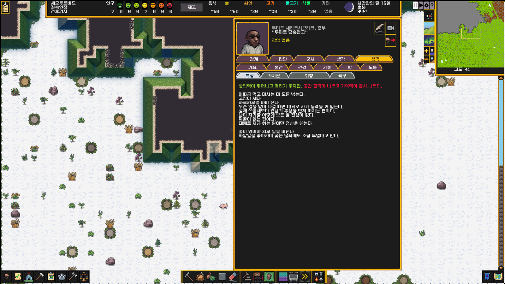

# Dwarf Fortress 한국어 패치 (시험판)

스팀판 Dwarf Fortress를 한국어로 플레이하는 **비공식** 한국어 패치입니다.
아직 시험판이고, 요새 모드와 전설 모드를 먼저 옮겼습니다.

> 대지를 강타하라!

| 주민 정보 | 전설 모드 |
|---|---|
|  |  |

- 게임 파일을 고치지 않습니다. 게임 폴더에 파일 하나와 폴더 하나를 넣고, 빼면 원래대로 돌아갑니다.
- 게임 안에서 **Ctrl+F2**를 누르면 한글과 영어가 바로 바뀝니다.
- 설치 프로그램이 새 버전을 알려 주고 받아 줍니다.

## 지원 버전과 필요한 것

- **Dwarf Fortress 53.17 스팀판** (Windows 64비트). 다른 버전에는 넣지 않습니다. 설치 프로그램이 게임 버전을 확인합니다.
- Windows 10 또는 11.
- 그 밖에 깔아야 할 것은 없습니다.
- DFHack과 같이 쓸 수 있습니다 (DFHack 53.17-r1에서 확인했습니다).

## 설치

1. **저장 파일을 백업합니다.** 패치는 저장 파일을 건드리지 않지만, 시험판이니 하던 요새는 따로 복사해 두세요.
   탐색기 주소 칸에 `%APPDATA%\Bay 12 Games\Dwarf Fortress` 를 붙여 넣고, 거기 있는 `save` 폴더를 다른 곳에 복사하면 됩니다.
   (게임 폴더 안에 `save` 폴더가 있다면 그 폴더를 복사하세요.)
2. 게임을 끕니다.
3. [릴리즈](https://github.com/fnrkp089/DwarfFortress_Kr/releases/latest)에서 `DwarfFortress_KR-v<버전>.msi`를 받아 실행합니다.
   관리자 권한을 묻지 않습니다. 설치가 끝나면 프로그램이 열립니다.
4. 게임 폴더와 게임 버전이 맞게 나왔는지 보고 **한글패치 적용**을 누릅니다.
   게임 폴더를 못 찾았으면 **폴더 변경**으로 `Dwarf Fortress.exe`가 있는 폴더를 골라 주세요.
5. 스팀에서 게임을 실행합니다.

다음부터는 바탕 화면이나 시작 메뉴의 **Dwarf Fortress 한국어 패치**로 프로그램을 엽니다.

## 업데이트

프로그램을 열면 새 버전이 올라왔는지 확인합니다. 새 버전이 있으면 무엇이 바뀌었는지 보여 주고 받을지 묻습니다.
**예**를 누르면 받아서 프로그램을 바꾸고 다시 열린 뒤, 게임에도 새 버전을 넣을지 묻습니다.

- 새 버전은 이 저장소의 릴리즈에서만 받습니다.
- 받은 파일이 올라온 것과 같은지(SHA-256) 확인한 뒤에만 넣습니다. 다르면 넣지 않고 지금 버전을 그대로 둡니다.
- 게임이 업데이트되면 한글이 꺼지고 게임을 켤 때 안내 창이 뜹니다. 게임은 영어로 그대로 실행됩니다.
  새 게임 버전에 맞춘 패치가 올라오면 프로그램이 알려 줍니다.

## 쓰는 법

- **한글 켜고 끄기**: 게임 안에서 Ctrl+F2.
- **한글 글꼴**: 프로그램에서 고릅니다. 같이 들어 있는 도트 글꼴(갈무리9, 갈무리11, 갈무리11 굵게)이나 가지고 있는 글꼴 파일을 쓸 수 있습니다.
- **이름 표기**: 드워프어 같은 원어 이름을 한글로 적을지(`Dumat Sheriksibrek` → `두마트 셰리크시브레크`), 뜻풀이 이름을 한국어로 옮길지(`The Tin Lances` → `주석창`) 고릅니다.
- **이름 옆의 영어 원문**: 생물과 물건의 이름 옆에 영어를 붙입니다(`호랑이 (tiger)`). 게임의 검색 칸이 영어만 받고, 위키도 영어 이름으로 찾아야 하기 때문입니다. 항상 / 검색할 때만 / 끔 가운데 고릅니다.
- 글꼴과 이름 표기는 게임을 다시 켜면 적용됩니다.

## 게임이 영어로 뜰 때

까닭은 셋 가운데 하나입니다.

- **Ctrl+F2를 눌렀을 때**: 한글과 영어를 바꾸는 키입니다. 다시 누르면 한글로 돌아옵니다.
- **게임이 업데이트됐을 때**: 한글이 꺼지고, 게임을 켤 때 안내 창이 뜹니다. 새 게임 버전에 맞춘 패치가 올라올 때까지 기다려 주세요. 올라오면 프로그램이 알려 줍니다.
- **게임이 켜지자마자(5초쯤 안에) 꺼진 다음**: 패치는 게임이 시작하다 멈춘 것으로 보고 다음 실행부터 한글을 꺼 둡니다. 프로그램을 열어 **한글패치 다시 적용**을 누르면 다시 켜집니다.

뒤의 두 경우는 프로그램의 **지난 실행** 줄에 까닭이 나옵니다.

## 패치 빼기와 프로그램 제거

1. 게임을 끄고, 프로그램에서 **원래대로**를 누릅니다. 게임 폴더에 넣었던 파일이 지워지고 게임은 영어로 돌아갑니다.
2. Windows 설정 → 앱 → 설치된 앱 → **Dwarf Fortress 한국어 패치** → 제거.

프로그램을 먼저 제거했다면 게임 폴더에서 `dfhooks.dll`(DFHack을 쓰면 `dfhooks_kr.dll`)과 `dfkr-data` 폴더를 직접 지우면 됩니다.
DFHack을 쓰는 경우 `dfhooks.dll`은 DFHack의 파일이니 지우지 마세요.

## 알려진 문제

- 일부 문장에서는 이름의 색이 아직 원문과 다릅니다: 경기 참가자를 늘어놓은 문장, 한 낱말짜리 짧은 이름(`Led`, `Nil`)이 든 문장, 책 제목과 장소에 같은 이름이 같이 나오는 문장.
- 이름 경계에서 색이 반 글자쯤 옆 글자로 번져 보일 수 있습니다 (한글 한 자가 한 칸 반을 차지해서입니다).
- 세계를 만드는 동안 Ctrl+F2로 한글을 껐다 켜면 연대기의 줄 나눔이 잠깐 달라집니다.
- 사람 이름 옆에 영어 원문을 붙이도록 켜면 시민 목록의 이름이 길어져 옆 칸의 글을 잠깐 덮을 수 있습니다.
- 세계 화면의 문명 목록에서 칸 끝에서 잘린 이름 줄과 그 아랫줄이 영어로 남습니다.
- 창이 뜨거나 쪽을 넘긴 첫 순간에 영어가 잠깐 보이거나 글이 겹쳐 보일 수 있습니다 (한두 프레임).
- 시와 그림 책의 제목 가운데 게임이 지어내는 구절(`It Weeps` 같은 것)은 영어로 남습니다.
- 이름 짓기와 검색 칸은 영어만 받습니다 (게임이 한글 입력을 받지 못합니다).
- 전설 모드의 이름을 눌렀을 때 같은 줄의 다른 이름이 열릴 수 있습니다 (번역문의 낱말 차례가 영어와 달라서입니다).
- 칸이 좁아 게임이 줄여 찍은 이름(`Light Yellow Dia...`)은 영어로 남습니다.
- 뜻이 여럿인 이름 낱말은 화면에 따라 다른 뜻으로 보일 수 있습니다 (`Seals`가 `인장` 대신 `물범`). 같은 거점 이름이 목록과 문장에서 다르게 나올 수 있습니다.
- 모험 모드는 손보지 않았습니다. 번역이 일부 들어 있지만 화면을 확인하지 않았습니다.
- 모드가 더한 생물과 재료의 이름은 영어로 남습니다.
- DFHack의 창은 영어 그대로입니다.
- 화면에서 아직 확인하지 못한 곳이 있습니다 (병원, 기묘한 기분, 야수 습격 알림 같은 드문 화면).
- 게임이 업데이트되면 한글이 꺼지고 안내 창이 뜹니다. 새 게임 버전에 맞춘 패치가 나올 때까지 영어로 실행됩니다.
- 게임이 켜지자마자(5초쯤 안에) 꺼지면 다음 실행부터 영어로 뜹니다. 프로그램에서 **한글패치 다시 적용**을 누르면 다시 켜집니다.

## 윈도우나 백신이 경고할 때

- 설치 파일에 코드 서명이 없습니다. 처음 실행할 때 **Windows의 PC 보호** 창이 뜨면 **추가 정보** → **실행**을 누르면 됩니다.
  바이러스가 탐지됐다는 뜻이 아니라, 서명이 없고 받은 사람이 적은 새 파일이라는 뜻입니다.
- 게임에 넣는 `dfhooks.dll`은 게임 안에서 "화면에 글자를 쓰는 함수"에 끼어들어 영어를 한글로 바꿉니다.
  게임에 끼어드는 방식이라 백신이 의심 파일로 볼 수 있습니다. 게임 파일과 저장 파일은 고치지 않습니다.
- 설치 프로그램에는 직접 만든 실행 파일(exe)이 없습니다. python.org가 서명한 Python과, 메모장으로 열어 볼 수 있는 소스(`app\patcher.py`)로 돕니다.

## 문제를 봤을 때

[이슈](https://github.com/fnrkp089/DwarfFortress_Kr/issues)로 알려 주세요. 영어로 남은 글, 어색한 번역, 겹치거나 잘린 글 모두 좋습니다.

1. 프로그램의 **문제 제보** 칸에서 **화면 기록**을 켭니다. (게임이 켜져 있어도 됩니다.)
2. 게임에서 문제가 난 화면을 다시 열어 봅니다.
3. 프로그램에서 **제보 묶음 만들기**를 누릅니다. 바탕 화면에 `DFKR_report_날짜.zip`이 만들어집니다.
4. **이슈 쓰러 가기**를 눌러, 어느 화면에서 무엇이 이상했는지 적고 묶음 파일을 올려 주세요. 화면 캡처가 있으면 가장 좋습니다.
5. 다 했으면 **화면 기록**을 끕니다.

묶음에는 화면에 찍힌 글의 기록, 번역이 없어 영어로 나온 글의 목록, 패치와 게임의 버전이 들어갑니다.
PC의 폴더 경로와 계정 이름은 묶을 때 지우고, 남지 않았는지 다시 확인합니다. 저장 파일은 들어가지 않습니다.

## 어떻게 동작하나요

Dwarf Fortress는 글자를 256칸짜리 도트 글꼴로만 찍어서, 텍스트 파일을 고쳐서는 한글이 나오지 않습니다.

1. 게임은 시작할 때 실행 파일 옆의 `dfhooks.dll`을 스스로 읽어 들입니다. DFHack이 쓰는 것과 같은 확장 자리입니다.
2. 이 DLL이 화면에 글자를 쓰는 함수에 끼어들어, 게임이 쓰려던 영어 문장을 번역 엔진에 넘깁니다.
3. 엔진은 통문장 사전 → 문장 틀 → 낱말 조합의 차례로 옮기고, 조사(이/가, 을/를)를 앞말의 받침에 맞춥니다.
4. 한글은 게임이 화면의 칸을 그리는 바로 그때 도트 글꼴로 덧그립니다.

게임 안의 글과 저장 파일은 영어 그대로라서, 패치를 빼면 흔적이 남지 않습니다.
DFHack이 깔려 있으면 `dfhooks_kr.dll`이라는 이름으로 넣어 DFHack과 같이 뜨게 합니다.

## 릴리즈에 올라가는 파일

| 파일 | 내용 |
|---|---|
| `DwarfFortress_KR-v<버전>.msi` | 설치 파일. 사용자 폴더(`%LOCALAPPDATA%\Programs\DFKr`)에 깔고 바로가기를 만듭니다 |
| `DwarfFortress_KR-update-v<버전>.zip` | 업데이트용 묶음. 깔린 프로그램이 받아서 `app\` 폴더를 통째로 바꿉니다 |
| `SHA256SUMS` | 위 두 파일의 해시 |

설치 폴더의 구성은 이렇습니다.

| 구성 | 내용 |
|---|---|
| `app\patcher.py` | 설치 프로그램. 이 저장소 `patcher/patcher.py`와 같습니다 |
| `app\dfhooks.dll`, `app\dfkr-data\` | 게임에 넣는 패치: 후킹 모듈, 번역 사전, 글꼴, 설정 |
| `app\cacert.pem` | 루트 인증서 목록 (Mozilla, certifi 배포본) |
| `runtime\` | [python.org](https://www.python.org/downloads/windows/) 공식 배포본. exe / dll / pyd 전부 Python Software Foundation과 Microsoft의 서명본 |

설치 파일은 [WiX](https://wixtoolset.org/)로 만듭니다 (`patcher/installer.wxs`, `patcher/build_package.py`).
서명 없는 설치 exe는 백신의 추정에 자주 걸려서 exe가 아니라 msi로 만듭니다.

## 이 저장소에 있는 것

- `patcher/`: 설치 프로그램의 소스와 설치 파일을 만드는 스크립트
- `docs/img/`: 화면 캡처
- `RELEASE_NOTES.md`: 버전마다 바뀐 것

후킹 모듈과 번역 엔진의 소스, 번역 원본은 정리한 뒤에 따로 공개할 예정입니다.

## 저작권과 라이선스

- 이것은 **비공식 팬 번역**입니다. Bay 12 Games, Kitfox Games와 관계가 없습니다.
- **Dwarf Fortress의 저작권은 Bay 12 Games에 있습니다.** 이 저장소와 배포 파일에 게임 파일은 들어 있지 않습니다.
- 비영리로 만들고 나눕니다. 권리자가 요청하면 내립니다.
- 번역은 AI의 도움을 받아 만들었고, 게임 화면을 보면서 고쳐 가는 중입니다. 아직 사람이 확인하지 못한 문장이 많습니다.
- 라이선스
  - 코드: [MIT](LICENSE)
  - 번역 데이터: [CC BY-NC 4.0](LICENSE-DATA.txt)
  - 글꼴 Galmuri: SIL OFL 1.1
  - 그 밖의 외부 저작물: [LICENSE-THIRD-PARTY.txt](LICENSE-THIRD-PARTY.txt)

## Thanks

This patch stands on the shoulders of people who solved the hard parts first and shared their work.

- **shevernitskiy and the dfint project** ([df-steam-hook-rs](https://github.com/dfint/df-steam-hook-rs), MIT): the hook structure that lets a translation live inside the Steam version of Dwarf Fortress. Without your open code, this project would not have started.
- **Viz** ([dfint-rust-cjk](https://gitee.com/vizv/dfint-rust-cjk), MIT): for showing that CJK text can be drawn in a game built around 256 characters, and for publishing how.
- **The Galmuri font** ([galmuri](https://github.com/quiple/galmuri) by Lee Minseo, SIL OFL 1.1): the pixel font that makes Hangul look at home in the fortress.
- **The DFHack team** ([dfhooks](https://github.com/DFHack/dfhooks), MIT): your documentation of the dfhooks interface is what lets mods like this one coexist with others.
- The authors of [retour](https://github.com/Hpmason/retour-rs) (BSD-2-Clause), [fontdue](https://github.com/mooman219/fontdue) (MIT / Apache-2.0 / Zlib), [memchr](https://github.com/BurntSushi/memchr) (Unlicense / MIT) and [iced-x86](https://github.com/icedland/iced) (MIT).
- **Tarn and Zach Adams**, for Dwarf Fortress itself. Losing is fun, in any language.

If anything here is credited wrongly, or you would like it changed or removed, please open an issue.
