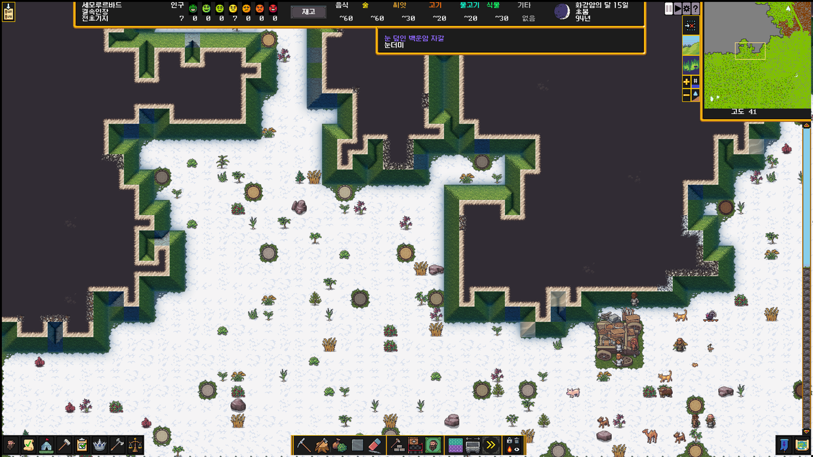
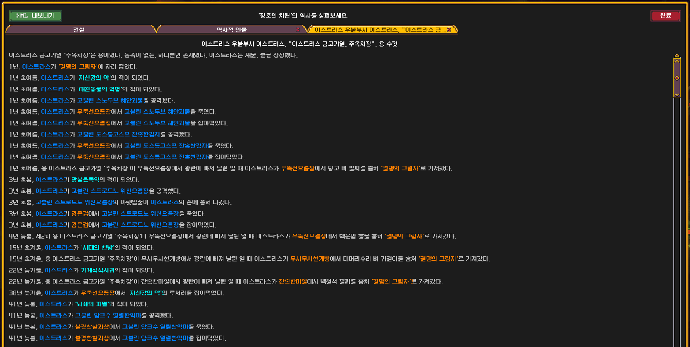
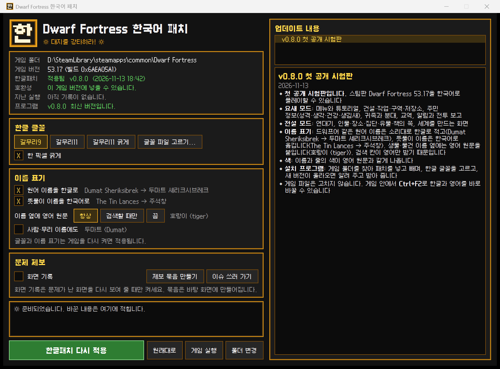

# Dwarf Fortress 한국어 패치 (시험판)

스팀판 Dwarf Fortress를 한국어로 플레이하는 **비공식** 한국어 패치입니다.
아직 시험판이고, 요새 모드와 전설 모드를 먼저 옮겼습니다.

> 대지를 강타하라!

| 주민 정보 | 전설 모드 |
|---|---|
|  |  |

- 게임 파일을 고치지 않습니다. 게임 폴더에 DLL 파일과 폴더 하나를 넣고, 빼면 원래대로 돌아갑니다.
- 게임 안에서 **Ctrl+F2**를 누르면 한글과 영어가 바로 바뀝니다.
- 게임 안에서 **Ctrl+F1**을 누르면 설정 창이 열립니다. 이름 표기, 이름 옆 영어 원문, 한글 검색을 게임을 끄지 않고 바꿉니다.
- 설치 프로그램이 새 버전을 알려 주고 받아 줍니다.
- 스팀 창작마당에서 구독해서 쓸 수도 있습니다. 새 버전은 스팀이 받아 옵니다.

## 지원 버전과 필요한 것

- **Dwarf Fortress 53.17 스팀판** (Windows 64비트). 다른 버전에는 넣지 않습니다. 설치 프로그램이 게임 버전을 확인합니다.
- Windows 10 또는 11.
- 그 밖에 깔아야 할 것은 없습니다.
- DFHack과 같이 쓸 수 있습니다 (DFHack 53.17-r1에서 확인했습니다).

## 설치

1. **저장 파일을 백업합니다.** 패치는 저장 파일을 건드리지 않지만, 시험판이니 하던 요새는 따로 복사해 두세요.
   탐색기 주소 칸에 `%APPDATA%\Bay 12 Games\Dwarf Fortress` 를 붙여 넣고, 거기 있는 `save` 폴더를 다른 곳에 복사하면 됩니다.
   (게임 폴더 안에 `save` 폴더가 있다면 그 폴더를 복사하세요.)
2. 게임을 끕니다.
3. [릴리즈](https://github.com/fnrkp089/DwarfFortress_Kr/releases/latest)에서 `DwarfFortress_KR-v<버전>.msi`를 받아 실행합니다.
   관리자 권한을 묻지 않습니다. 설치가 끝나면 프로그램이 열립니다.
4. 게임 폴더와 게임 버전이 맞게 나왔는지 보고 **한글패치 적용**을 누릅니다.
   게임 폴더를 못 찾았으면 **폴더 변경**으로 `Dwarf Fortress.exe`가 있는 폴더를 골라 주세요.
5. 스팀에서 게임을 실행합니다.

다음부터는 바탕 화면이나 시작 메뉴의 **Dwarf Fortress 한국어 패치**로 프로그램을 엽니다.

## 스팀 창작마당으로 설치하기

창작마당에서 구독해 두면 새 버전을 스팀이 알아서 받아 옵니다. 설치 프로그램(msi) 없이 쓸 수 있습니다.

1. 게임을 끕니다. 하던 요새가 있으면 위의 1번처럼 저장 폴더를 먼저 복사해 두세요.
2. [창작마당 항목](https://steamcommunity.com/sharedfiles/filedetails/?id=3839901324)을 구독하고 받기가 끝날 때까지 기다립니다.
3. 구독 폴더의 `DFKR_Install.bat`을 한 번 실행합니다. **구독만으로는 한글이 나오지 않습니다.**
   - 구독 폴더는 `<스팀 라이브러리>\steamapps\workshop\content\975370\3839901324` 입니다.
     스팀에서 게임 오른쪽 클릭 → 관리 → 로컬 파일 보기로 게임 폴더를 연 뒤, 두 단계 위의 `steamapps` 폴더에서 `workshop\content\975370\3839901324`로 들어가면 됩니다.
   - 구독 폴더를 찾기 어려우면 [릴리즈](https://github.com/fnrkp089/DwarfFortress_Kr/releases/latest)에서 `DFKR_Install.bat`만 받아서 실행해도 됩니다. 구독 폴더를 스스로 찾아서 설치합니다.
   - 게임 폴더를 못 찾았다고 나오면 Dwarf Fortress 폴더나 `Dwarf Fortress.exe`를 `DFKR_Install.bat` 위에 끌어다 놓으세요.
4. 스팀에서 게임을 실행합니다.

- 설치 파일은 게임 폴더에 작은 로더 파일 하나(`dfhooks.dll`과 `dfhooks_kr.dll` 두 이름으로. DFHack이 있으면 `dfhooks_kr.dll`만)와 `dfkr-data` 폴더만 놓습니다. 번역 엔진, 사전, 글꼴은 구독 폴더에 그대로 있고 스팀이 갱신합니다.
  관리자 권한을 쓰지 않고 인터넷에서 아무것도 받지 않습니다. 메모장으로 열면 하는 일이 전부 적혀 있습니다.
- **세계를 만들 때 모드 목록에는 넣지 마세요.** 넣지 않아도 한글이 나옵니다.
- 설치 프로그램으로 쓰다가 창작마당으로 바꿔도 됩니다. `DFKR_Install.bat`이 알아서 바꾸고, 글꼴과 이름 표기 설정은 그대로 둡니다.
  - **설치 프로그램을 계속 쓰려면 프로그램을 열어 먼저 최신 버전으로 업데이트하세요.** 0.8.5 이하의 프로그램은 창작마당 방식을 모릅니다.
    업데이트하지 않은 예전 프로그램에서 **한글패치 적용**을 누르면 한국어 패치가 알림 없이 예전 버전으로 돌아갑니다.
    그렇게 됐으면 `DFKR_Install.bat`을 다시 실행하면 됩니다. `DFKR_Install.bat`도 바꿀 때 검은 창에 이 안내를 보여 줍니다.
- 글꼴이나 이름 표기를 바꾸려면 설치 프로그램(msi)을 같이 깔아 설정 창으로 쓰면 됩니다.
  창작마당으로 설치한 게임에서는 프로그램의 **한글패치 적용**과 프로그램 업데이트가 꺼져 있고 설정만 바꿉니다.
- `DFKR_Install.bat`을 다시 실행해야 하는 때: DFHack을 깔거나 지운 뒤 영어로 뜰 때, 스팀 라이브러리를 다른 곳으로 옮긴 뒤 영어로 뜰 때, 게임이 켜지다 꺼진 뒤 영어로 뜰 때.
- 창작마당에 새 버전이 올라와도 스팀이 바로 받지 않을 때가 있습니다. 스팀을 한 번 껐다 켜면 받습니다.
- 빼려면 구독을 취소하기 **전에** 구독 폴더의 `DFKR_Uninstall.bat`을 실행합니다 (릴리즈에도 같은 파일이 있고, 게임 폴더의 `dfkr-data` 안에도 하나 있습니다).

## DFHack과 같이 쓰기

같이 쓸 수 있습니다. DFHack의 창과 명령은 번역하지 않고 영어 그대로 둡니다. (게임 화면 위에 얹히는 오버레이의 낱말 몇 개는 아직 한글로 바뀔 수 있습니다.)

DFHack을 깔거나 지운 뒤에 게임이 영어로 나오면 `DFKR_Install.bat`을 한 번 더 실행하세요. 설치 프로그램으로 깔았으면 프로그램을 열어 **한글패치 다시 적용**을 누르세요.

## 업데이트

프로그램을 열면 새 버전이 올라왔는지 확인합니다. 새 버전이 있으면 무엇이 바뀌었는지 보여 주고 받을지 묻습니다.
**예**를 누르면 받아서 프로그램을 바꾸고 다시 열린 뒤, 게임에도 새 버전을 넣을지 묻습니다.

- 새 버전은 이 저장소의 릴리즈에서만 받습니다.
- 받은 파일이 올라온 것과 같은지(SHA-256) 확인한 뒤에만 넣습니다. 다르면 넣지 않고 지금 버전을 그대로 둡니다.
- 게임이 업데이트되면 한글이 꺼지고 게임을 켤 때 안내 창이 뜹니다. 게임은 영어로 그대로 실행됩니다.
  새 게임 버전에 맞춘 패치가 올라오면 프로그램이 알려 줍니다.
- 창작마당으로 설치했다면 새 버전은 스팀이 받아 옵니다. 프로그램으로 업데이트하지 않습니다.

## 쓰는 법

- **설정 창**: 게임 안에서 Ctrl+F1 (타이틀 화면에서도 열립니다). 위아래 화살표로 칸을 고르고 Enter나 마우스로 바꿉니다. Esc, 마우스 오른쪽 단추, Ctrl+F1로 닫습니다. 칸은 일곱입니다: 한글 표시, 뜻풀이 이름을 한국어로, 원어 이름을 한글로, 이름 옆 영어 원문 (항상 / 검색할 때만 / 끔), 사람·장소 이름에도 영어 원문, 한글 검색, 첫 순간 맞추기. 바꾸면 바로 적용되고 `dfkr-data` 폴더의 `config.txt`에 적힙니다 (바꾸기 직전의 파일은 `config.txt.bak`). 창이 열린 동안에는 키와 마우스가 게임에 닿지 않습니다.
- **한글 켜고 끄기**: 게임 안에서 Ctrl+F2.
- **첫 순간 맞추기 끄고 켜기**: 게임 안에서 Ctrl+F5. 창을 연 첫 순간의 글을 맞추는 기능입니다 (하는 일의 `낚시`·`마시기`, 알림 창의 광물 이름 옆 영어). 화면의 글이 이상하면 꺼 보세요. 누르면 화면에 2초쯤 `[한패] 첫 순간 맞추기 꺼짐` / `켜짐`이 뜨고, 바꾼 값은 게임을 다시 켜도 그대로입니다.
- **한글 글꼴**: 프로그램에서 고릅니다. 같이 들어 있는 도트 글꼴(갈무리9, 갈무리11, 갈무리11 굵게)이나 가지고 있는 글꼴 파일을 쓸 수 있습니다.
- **이름 표기**: 드워프어 같은 원어 이름을 한글로 적을지(`Dumat Sheriksibrek` → `두마트 셰리크시브레크`), 뜻풀이 이름을 한국어로 옮길지(`The Tin Lances` → `주석 창`) 고릅니다.
- **이름 옆의 영어 원문**: 생물과 물건의 이름 옆에 영어를 붙입니다(`호랑이 (tiger)`). 게임의 검색 칸은 대부분 영어만 받고, 위키도 영어 이름으로 찾아야 하기 때문입니다. 작업을 고르는 목록에서는 작업 이름에도 붙고(`나무 통 만들기 (make wooden barrel)`), 지도에 마우스를 올리면 뜨는 이름 상자에서는 땅과 건물 이름에도 붙습니다. 항상 / 검색할 때만 / 끔 가운데 고릅니다.
- **한글 검색**: 재고 창, 작업장의 새 작업 추가 목록, 주민 목록, 부엌, 작업 지시의 새 지시 고르기, 교역소의 물건 고르는 목록의 검색 칸에는 한글로 칠 수 있습니다. 치는 글자가 바로 목록에 걸러지고, 초성만 쳐도 찾습니다 (`ㅊㄷ` → `침대 만들기`). 검색 칸을 나가면 자판이 한글 상태여도 게임 단축키가 그대로 먹습니다. 다른 검색 칸과 이름을 짓는 칸은 영어만 받습니다. 끄려면 게임 폴더의 `dfkr-data\config.txt`에서 `[HANGUL_SEARCH:NO]`.
- 설치 프로그램에서 바꾼 글꼴과 이름 표기는 게임을 다시 켜면 적용됩니다. 게임 안의 설정 창(Ctrl+F1)에서 바꾼 것은 바로 적용됩니다 (글꼴은 설정 창에서 바꿀 수 없습니다).

## 게임이 영어로 뜰 때

까닭은 셋 가운데 하나입니다.

- **Ctrl+F2를 눌렀을 때**: 한글과 영어를 바꾸는 키입니다. 다시 누르면 한글로 돌아옵니다.
- **게임이 업데이트됐을 때**: 한글이 꺼지고, 게임을 켤 때 안내 창이 뜹니다. 새 게임 버전에 맞춘 패치가 올라올 때까지 기다려 주세요. 올라오면 프로그램이 알려 줍니다.
- **게임이 켜지자마자(5초쯤 안에) 꺼진 다음**: 패치는 게임이 시작하다 멈춘 것으로 보고 다음 실행부터 한글을 꺼 둡니다. 프로그램을 열어 **한글패치 다시 적용**을 누르면 다시 켜집니다.

뒤의 두 경우는 프로그램의 **지난 실행** 줄에 까닭이 나옵니다.

분대·장소·책 같은 **이름만 영어로 나올 때**는 Ctrl+F1 설정 창에서 `뜻풀이 이름을 한국어로`를 켜세요. 그 자리에서 한글로 바뀝니다.

창작마당으로 설치했다면 **한글패치 다시 적용** 대신 구독 폴더의 `DFKR_Install.bat`을 한 번 더 실행합니다.
구독 폴더의 파일이 받는 도중이거나 깨졌을 때도 게임은 영어로 실행되고 안내 창이 뜹니다. 받기가 끝난 뒤 게임을 다시 켜면 됩니다.

## 패치 빼기와 프로그램 제거

1. 게임을 끄고, 프로그램에서 **원래대로**를 누릅니다. 게임 폴더에 넣었던 파일이 지워지고 게임은 영어로 돌아갑니다.
2. Windows 설정 → 앱 → 설치된 앱 → **Dwarf Fortress 한국어 패치** → 제거.

프로그램을 먼저 제거했다면 게임 폴더에서 `dfhooks.dll`, `dfhooks_kr.dll`과 `dfkr-data` 폴더를 직접 지우면 됩니다.
DFHack을 쓰는 경우 `dfhooks.dll`은 DFHack의 파일이니 지우지 마세요.

창작마당으로 설치했다면 구독을 취소하기 전에 구독 폴더의 `DFKR_Uninstall.bat`을 실행합니다 (위 "스팀 창작마당으로 설치하기").

## 알려진 문제

- **이름이 영어로 나오면 `Ctrl+F1` 설정 창에서 `뜻풀이 이름을 한국어로`를 켜 주세요**: 꺼 두면 분대·장소·신전·시 형식·유물 이름과 괴물의 별명이 영어 그대로 나옵니다. 그 이름이 든 글 가운데 틀까지 영어로 남는 것이 아직 많습니다: 전설의 사건 문장, 관계 목록의 `The Adoration of Fangs (enemy)`, 섬기는 신 줄의 `Ab the Satiny Duties, object of worship` 같은 줄입니다. 켜면 그 자리에서 한글로 바뀝니다 (`소리없는보금자리의 남작이`, `분대: 청동교역`). 게임을 다시 켜지 않아도 됩니다.
- 설정 창이 열려 있어도 게임의 시간은 멈추지 않습니다. 시간이 흐르던 중이면 계속 흐릅니다. 일시 정지해 두고 여세요.
- `한글 검색`을 꺼 둔 채로 켠 게임에서는 설정 창에서 켜도 게임을 다시 켠 뒤에 적용됩니다 (그 칸의 설명이 노란 글로 알려 줍니다). 켠 채로 시작한 게임에서는 끄고 켜는 것이 바로 됩니다.
- `원어 이름을 한글로`만 꺼 두면 원어 이름이 든 뜻풀이 이름도 영어 그대로 나옵니다 (드워프 정보 창 머리의 `"Likot Graniteaces"`)
- 글꼴과 글자 크기는 설정 창에서 바꿀 수 없습니다. 설치 프로그램이나 `config.txt`에서 바꾸고 게임을 다시 켭니다.
- 설정 파일을 쓸 수 없는 자리이거나 파일의 글자가 깨져 있으면 바꾼 값은 그 실행에만 적용되고 창 아래에 알림이 뜹니다. 게임은 그대로 돌아갑니다.
- 설정 파일에 그 설정의 줄이 없으면 (옛 판에서 쓰던 파일의 `첫 순간 맞추기`) 파일 끝에 주석 한 줄과 함께 덧붙입니다.
- 패치를 통째로 꺼 둔 게임(`config.txt`의 `[ENABLED:NO]`)과 한글이 꺼진 채 뜬 게임(게임 업데이트 뒤)에서는 설정 창이 열리지 않습니다.
- 설정 창은 DFHack을 같이 쓰는 게임에서 확인하지 못했습니다. 창이 열린 동안에도 Ctrl·Alt 없이 쓰는 DFHack 단축키는 DFHack이 먼저 받습니다.
- 새로 고른 기술 이름 여덟(`회피자`, `발길질꾼`, `물어뜯는 이`, `달램꾼`, `눈치꾼`, `목발꾼`, `잡동사니 싸움꾼`, `갑옷 입은 이`)은 처음 써 보는 말입니다. 어색하면 알려 주세요. `방패 사용자`·`칼 사용자`·`활 사용자`는 이번에 그대로 두었습니다.
- 기술 줄 가운데 사람을 가리키는 말이 없는 넷은 `기술: 등급` 꼴입니다 (`규율: 어설픔`, `집중: 익숙함`, `젖 짜기: 초보`, `털 깎기: 숙달함`)
- 군대를 이끄는 지휘관을 소개하는 침공 알림(`재능 있는 지휘관이자 숙련된 전사다`)과 평판 줄의 일부는 문장으로 옮긴 글이라 등급 낱말과 다른 말을 씁니다.
- 생물이 든 우리의 이름은 번역 엔진에 넣어 확인했고 화면에서는 보지 못했습니다. 우리 하나에 생물이 여럿 들었거나 이름이 붙은 생물이 든 우리는 영어로 남을 수 있습니다. 보이면 알려 주세요.
- 동물 사람의 암컷 이름(`수달 여인` 같은 것)은 성별 표시가 같이 찍혀도 그대로입니다 (`수달 여인 (♀)`)
- 이번에 고친 낱말과 표지는 번역 엔진과 모아 둔 화면 글 7만 줄로 확인했습니다. 죽은 까닭, 알림 종류, 동물의 훈련 정도, 귀족의 직함, 작품 평, 이름을 묻는 글은 화면에서 보지 못했습니다.
- 한글 검색이 되는 검색 칸은 여섯입니다: 재고, 작업장의 새 작업 추가, 주민 목록, 부엌, 작업 지시의 새 지시 고르기, 교역소의 물건 고르는 목록. 다른 검색 칸(저장소 설정, 건설 재료, 전설, 개체 시험장)에는 한글이 들어가지 않습니다. 영어로 쳐 주세요.
- 한/영 키는 검색 칸에 커서를 넣은 뒤에 눌러야 바뀝니다. 검색 칸 밖에서는 한/영 키가 먹지 않습니다 (한글 입력기를 떼어 둡니다). 바꾼 상태는 칸을 나갔다 돌아와도 그대로입니다.
- 이름을 짓는 칸(저장소·작업조 이름, 별명, 직업 이름 …)은 영어로 쳐 주세요. 자판이 한글 상태로 치면 한글 대신 자판의 영어 글자가 들어갑니다 (`한`을 치면 `gks`)
- 마우스를 누른 뒤 0.7초 안에 누른 글자 단축키는 자판이 한글 상태면 먹지 않을 수 있습니다 (검색 칸을 눌렀을 수 있어서 그동안은 한글 입력기를 붙여 둡니다)
- 첫 순간 맞추기를 꺼 둔 동안(Ctrl+F5)에도 검색 칸에 새 한글을 칠 수 없습니다 (검색 칸을 알아보는 데 같은 장치를 씁니다). 끄기 전에 친 한글 검색어는 그대로 보이고 그대로 걸러져 있습니다.
- 한글 검색은 윈도우의 기본 한글 입력기(두벌식)로 확인했습니다. 세벌식 자판, 다른 입력기, 한자 키로는 확인하지 못했습니다. 한글이 안 들어가거나 칸의 글이 이상하면 어느 창에서 무엇을 쳤는지 알려 주세요.
- 검색 칸을 누른 직후 커서(`_`)가 보이기 전에 친 한글은 들어가지 않을 수 있습니다. 커서가 깜빡이는 것을 보고 치면 됩니다.
- 번역이 없어 영어로 남는 줄은 한글로 찾을 수 없습니다 (영어로 찾습니다). 주민 이름은 화면에 한 번 보인 한글 표기로 찾습니다: 아직 화면에 안 나온 아랫줄의 주민은 직업과 하는 일로는 찾아지지만 이름으로는 안 찾아질 수 있습니다.
- 물건이 아주 많은 요새에서는 한글로 처음 찾을 때 일부 줄이 빠졌다가 한 자 더 치면 나올 수 있습니다 (화면에 안 보인 줄의 번역을 조금씩 나눠 합니다. 확인한 요새에서는 나오지 않았습니다)
- 한글 출력을 꺼 둔 동안(Ctrl+F2)에는 검색 칸에 한글을 칠 수 없습니다 (자판이 한글 상태여도 영어 글자가 들어갑니다). 끄기 전에 친 한글 검색어는 그대로 보이고 목록도 그대로 걸러져 있습니다.
- 한글 검색은 DFHack을 같이 쓰는 게임에서 확인하지 못했습니다. DFHack 창의 검색 칸은 영어만 받습니다.
- 게임이 업데이트되면 한글 검색은 새 게임 버전에서 검색 칸의 자리를 다시 확인할 때까지 꺼질 수 있습니다 (그동안은 예전처럼 영어로 찾습니다)
- 물건 창의 위치 줄에서 그릇 이름이 칸에 잘리면 영어 그대로입니다 (`In ≡dwarven wine Barrel (ashen...`). 잘리지 않은 줄은 `보관: ≡드워프 포도주 통 (물푸레나무) <#2>≡`입니다.
- 긴 물건 이름이 칸에 잘린 줄은 영어로 남습니다 (드워프 정보 창 물건 탭의 `(giant peregrine falcon leather face v...`). 그 물건의 창 머리에서는 이름 줄과 주인 줄, 무게 줄이 한 글로 묶여 일부가 영어로 섞입니다 (`주인: 준티르 아메모돔, Dwarven C... Weight:`)
- 좁은 칸에서 게임이 모음을 빼서 줄여 찍은 이름은 영어 그대로입니다 (드워프 정보 창 개요의 `못 채운 욕구: 기도 Mingtth Plyjwls`. 창이 넓으면 `기도 밍투스 놀이주옥`)
- 시·음악·춤 형식의 설명은 첫 문단만 옮겨집니다. 구성을 풀어 쓴 뒷문단(`The poem is divided into two tercets and an octet. …`)은 영어로 남습니다.
- 별명을 지어 준 주민의 이름은 별명을 친 그대로 둡니다 (``민병대장 `puncher' 콘콜``). 별명의 따옴표도 게임이 찍는 꼴 그대로입니다.
- 드워프 아이도 어른과 같은 말씨(하오체)로 말합니다 (`"술 한 잔이 간절하오."`). 아이의 말씨는 따로 손볼 예정입니다.
- 소문·첩보 알림, 조각상·추모비 이름, 방문객이 찾아온 까닭이 둘 이어진 글, 도둑이 들키며 하는 말은 번역 엔진에 넣어 확인했고 화면에서는 보지 못했습니다.
- 지어낸 악기 이름은 원래 철자 그대로 둡니다. 이름만 혼자 찍힌 줄은 그래서 영어 그대로이고, 악기를 설명하는 긴 문단은 아직 옮기지 않았습니다. 두 글자짜리 이름은 작업 이름(만들기·벼리기·조립)에서만 알아보고, 물건 목록에 찍힌 줄(`ub drum`, `iron ub`)은 영어로 남습니다.
- 곡 제목 가운데 게임 낱말과 글자가 같은 여덟(`Dwarf Fortress`, `Forgotten Beast`, `Mountainhome`, `Night Creature` …)은 곡 줄이 뜨는 첫 순간에 한 프레임 동안 한글로 보일 수 있습니다. 곡 줄은 번역 엔진에 넣어 확인했고 화면에서는 보지 못했습니다.
- 심문 보고서의 털어놓은 일은 번역 엔진에 넣어 확인했고 화면에서는 보지 못했습니다. 네 가지 말고 다른 음모 문장은 영어로 남습니다.
- 혼자 찍힌 `Block`은 `블록`으로 옮깁니다. 어느 화면에 혼자 찍히는지는 확인하지 못했습니다.
- 신 이름의 별칭이 전설의 인물 목록에서만 다른 낱말로 나올 수 있습니다. 영어 꼴이 같은 낱말이 둘일 때(`fair`: 공평한 / 해사한), 원어 이름이 같이 찍히는 인물 목록 줄은 원어로 뜻을 가려 `알론 앙겐, "알론, 해사한 자"`로, 영어 이름만 찍히는 기도 줄과 신전 줄은 `알론 '공평한 자'`로 옮깁니다.
- `The` 뒤에 직업·시설·생물 이름 하나만 오는 글은 사전의 말로 옮깁니다. 그런 이름을 가진 집단이나 장소가 있다면 (`The Still`) 지어낸 이름이 아니라 보통 낱말(`양조장`)로 나옵니다 (모아 둔 화면 글 7만 줄에서는 그런 이름을 찾지 못했습니다)
- 정예 군인의 칭호(`창의 달인` …)는 번역 엔진에 넣어 확인했고 화면에서는 보지 못했습니다 (시험한 요새에 그 칭호의 군인이 없습니다)
- 급한 욕구로 하는 일이 칸에 잘렸을 때의 느낌표는 글자색으로 압니다. 게임을 켠 뒤 느낌표로 끝나는 하는 일(`숭배!`, `… 기도!`)이 주민 목록에 한 번 찍힌 다음부터 붙습니다 (그 색을 거기서 배웁니다)
- 말줄임표 `…`는 한글 글꼴로 그립니다. 직접 고른 글꼴에 그 글자가 없으면 마침표 둘(`..`)로 대신 그립니다.
- 이름이 혼자 찍히는 자리(전설의 인물 목록, 드워프 정보 창의 관계 탭, 못 채운 욕구 줄의 이름)에서는 별칭을 쉼표로 잇습니다 (`리물, 사프란`). 기도 줄과 신전 줄, 섬기는 신 줄, 문장 속에서는 `리물 '사프란'`입니다. 혼자 찍힌 이름은 신과 사람·괴물·유물을 글자로 가를 수 없어서 이번에는 그대로 두었습니다.
- 칸에 잘린 줄은 잘리기 전의 글을 찾지 못하면 영어 그대로입니다. 끊긴 낱말을 이을 낱말이 여럿이고 그 이름이 아직 화면에 온전하게 나온 적이 없을 때입니다 (게임을 켠 뒤 처음 보는 손님의 `Guest / Pray to Ibu the Mauve Co...`). 그 이름이 온전하게 찍히는 화면(그 드워프의 정보 창, 신전 목록)을 한 번 열면 되살아납니다. 게임을 다시 켜면 다시 처음부터입니다.
- 창을 여는 첫 순간에 글의 자리가 반 칸에서 두 칸쯤 옮겨 보이는 것은 그대로입니다 (건설 메뉴를 여는 첫 프레임의 `군사`). 가운데·오른쪽 맞춤은 지난 화면을 보고 정합니다.
- 안내 창과 설명 풍선의 글은 첫 순간 맞추기에 들지 않습니다 (지금까지처럼 화면에 뜬 뒤 한두 프레임 안에 한글이 됩니다)
- 게임 화면 위에 얹히는 DFHack 오버레이에서는 낱말 넷이 아직 한글로 바뀝니다: `Mood: Content` → `Mood: 흡족함`, `Progress Bar: Yes` → `Progress Bar: 예`, `Experience: Yes` → `Experience: 예`, `Ctrl+b: Butcher` → `Ctrl+b: 도축업자`.
- DFHack과 같이 쓰다가 DFHack만 지우면 게임이 알림 없이 영어로 돌아갑니다 (게임이 읽는 `dfhooks.dll`이 DFHack과 함께 없어집니다). `DFKR_Install.bat`을 한 번 더 실행하거나 프로그램에서 **한글패치 다시 적용**을 누르면 한글로 돌아옵니다.
- 0.13.2까지의 버전으로 깔아 둔 게임은 한 번 다시 설치하기 전에는 DFHack을 새로 깔 때도 영어로 돌아갑니다. 같은 방법으로 돌아옵니다.
- DFHack의 창이 떠 있는 동안에는 그 밑에 깔린 게임 화면에서 드워프의 성격 설명, 부상 목록, 출정 준비 화면의 탭이 영어로 보입니다. 창을 닫으면 한글로 돌아옵니다 (화면에서 확인하지는 못했습니다)
- DFHack은 53.17-r1의 압축 파일을 풀어 넣은 게임에서 확인했습니다. 스팀으로 깐 DFHack에서는 아직 확인하지 못했습니다. DFHack의 창 가운데 화면에서 확인한 것은 실행기입니다.
- 정보 창 `노동` 탭 돌 사용의 쓰임새 `Ore of copper`는 `구리의 광석` 그대로입니다 (`의`를 빼면 그 줄만 이름 옆 영어가 빠져서 두었습니다)
- 못 채운 욕구 목록에서 기도할 신의 이름이 붙는 줄은 `~하기` 꼴이 아니고 말이 끊깁니다 (`못 채운 욕구: 기도 리물, 사프란`). 이름이 칸을 넘으면 `…`으로 잘립니다 (`기도 아발 황톳빛석탄, 청…`)
- 모드가 더한 물건 이름에 꾸밈말이 들어 있으면 재료가 꾸밈말 앞에 옵니다 (`Make leather heavy cuirass` → `가죽 무거운 흉갑 만들기`)
- 낱말과 낱말 사이에서 딱 잘린 줄은 빠진 낱말을 알 수 없어서 앞부분만 옮깁니다 (`Forge pair of steel ...` → `강철 한 켤레 벼리기 ...`). 끊긴 낱말을 이을 낱말이 여럿인 줄은 영어 그대로입니다 (`Weave yarn int...`, `Timeesteems the Ape of Bl...`). 온전한 작업 이름이 다른 화면에 나온 뒤에는 되살아납니다.
- 저장한 세계가 쓰던 모드의 새 판이 있을 때 뜨는 창에서 모드 이름과 판 번호 줄은 영어 그대로입니다 (`Detailed Weather 1.5 (save uses 1.4, not found)`)
- 모드 번역은 네 모드만 됩니다 (`VWO Extended`, `Rebalanced Metals Extended`, `USEFUL TOYS`, `Tougher Bodies`). 다른 모드가 더한 생물·재료·물건의 이름은 영어로 남습니다.
- 모드 번역 가운데 화면에서 확인한 것은 금속·무기·방어구 이름과 용광로·대장간의 작업 이름입니다. 장난감 이름, 전투 기록의 새 동사, 증상 이름은 확인하지 못했습니다. 영어로 남거나 어색한 이름이 보이면 모드 이름과 함께 알려 주세요.
- `More Book Titles`가 더한 책 제목은 영어로 남습니다.
- 세계를 만들 때 모드를 고르는 화면에서 모드 이름과 설명이 일부만 옮겨져 섞여 보입니다 (`Rounded Hills`가 `둥근 언덕`, 만든 이 `A Nickel`이 `니켈`). 모드가 적은 글이라 원문 그대로 두는 쪽으로 고칠 예정입니다.
- 금속 `cobalt`가 낱말 하나로 혼자 찍히는 자리에서는 색 이름 `코발트색`으로 나옵니다 (출정할 곳을 고르는 지도의 광물 줄 `철 구리 니켈 백금 코발트색`). 물건 이름과 작업 이름, 주괴, 대장간의 재료 메뉴에서는 `코발트`입니다.
- 이름이 길면 좁은 목록에서는 이름 옆 영어가 `…`으로 잘려 붙고, 영어가 여섯 자도 안 들어가는 줄에서는 영어가 빠집니다 (모드 물건이 많은 출발 준비 화면의 오른쪽 목록. 이번 판에서는 그 화면을 다시 확인하지 못했습니다)
- 모드의 번역은 그 모드가 PC에 있으면 읽습니다. 그 모드를 넣지 않은 세계에서도 읽지만, 게임에 원래 있는 글의 번역은 달라지지 않습니다.
- 모드가 DFHack 스크립트로 찍는 글(`USEFUL TOYS`의 알림, `Detailed Weather`, `Rain Visuals`, `RPG Quality Grades`)은 영어 그대로입니다.
- 드워프 정보 창과 정보 창의 `작업` 탭은 그 창을 세 번쯤 열어 보기 전까지, 여는 첫 순간에 하는 일이 한 프레임 동안 `물고기`·`술`로 보일 수 있습니다 (패치를 새로 깔았거나 새 버전으로 바꾼 직후). 주민 목록은 처음부터 `낚시`·`마시기`로 나옵니다.
- 작업장의 대기 작업 줄과 교역소의 물건 고르는 목록은 창을 연 첫 순간에 영어가 한 프레임 늦게 붙습니다.
- Ctrl+F5를 눌렀을 때의 알림은 한글 출력을 꺼 둔 동안(Ctrl+F2)과 화면에 빈 줄이 없을 때는 뜨지 않습니다. 켜고 끄기는 그대로 됩니다.
- 첫 순간 맞추기는 DFHack을 같이 쓰는 게임에서 확인하지 못했습니다. 화면의 글이 이상하면 Ctrl+F5로 꺼 보세요.
- 분대를 고른 동안에는 혼자 찍힌 `Paste`를 `붙여넣기`로 옮깁니다. 그 화면에 물건 종류 `반죽`이 같이 찍히는 창이 있으면 그것도 `붙여넣기`로 보입니다 (그런 창은 찾지 못했습니다)
- 작업 이름 칸, 물건 목록, 작업장의 대기 작업 줄, 지난 알림 목록은 화면의 탭 줄과 제목 글에서 자리를 찾습니다. 화면 폭 125칸·160칸·182칸에서 확인했습니다. 창의 배치가 다르면 (DFHack으로 창을 옮기거나 크기를 바꾼 경우는 확인하지 못했습니다) 자리를 못 찾고 예전처럼 나옵니다: 하는 일이 `물고기`·`술`로, 물건 목록의 영어는 스크롤 자리에 따라 붙었다 빠졌다 하고, 대기 작업 줄과 광물 알림에는 영어가 안 붙습니다.
- 물건 목록에서 영어를 붙이면 칸을 넘는 줄은 영어가 `…`으로 잘립니다. 창이 좁을수록 그런 줄이 늘고, 영어가 여섯 자도 안 들어가면 한글만 나옵니다.
- 교역소의 물건 고르는 목록에서 묶음을 전부 접은 채로 왼쪽 갈래 목록을 스크롤해 그 창에서 처음 보는 갈래가 나오면, 물건 줄이 다시 보일 때까지 왼쪽 갈래의 영어가 빠질 수 있습니다 (갈래가 많아 왼쪽 목록이 스크롤되는 요새. 확인하지 못했습니다)
- 작업장의 대기 작업 줄에서 영어를 붙이면 오른쪽 단추에 닿는 긴 작업 이름은 영어가 `…`으로 잘립니다. 이름 옆 영어를 `검색할 때만` 보이게 한 설정에서는 대기 작업 줄에 영어가 붙지 않습니다 (검색 칸이 없는 창입니다)
- 광물 알림의 영어는 지난 알림 목록과 왼쪽 알림 아이콘을 눌렀을 때 뜨는 창에서 붙습니다. 알림 아이콘에 마우스를 올리면 뜨는 상자와 화면에 뜨는 알림에는 붙지 않습니다. 걸작, 도둑, 떠돌이 동물 같은 다른 알림과 두 줄로 접힌 알림에도 붙지 않습니다.
- 지난 알림 목록의 맨 윗줄이 광물 알림이고 그 번역문이 원문보다 길면, 목록을 연 첫 순간에 그 줄만 영어가 한 프레임 늦게 붙습니다.
- 물건 목록 말고도 이름과 분류 이름이 섞인 짧은 목록은 메뉴로 보고 영어를 붙이지 않습니다 (작업장 창에서 작업 줄에 마우스를 올리면 뜨는 왼쪽 상자의 `침대`·`통나무`, 저장소 설정과 건설 메뉴)
- 뜻풀이 이름을 옮기지 않는 설정에서: 원어 이름이 하나로 정해지지 않는 사람 이름은 그 사람을 원어 이름으로 먼저 보기 전까지 영어로 나옵니다. 한 번 영어로 찍힌 줄은 게임을 다시 켤 때까지 영어로 남을 수 있습니다. 별칭이 붙은 이름(`Lun Moistnesspaddled the Sunken Fish of Ships`)과 집단·장소·유물의 뜻풀이 이름은 설정대로 영어로 나옵니다.
- 구역을 한꺼번에 놓을 때의 가구 제외 줄 가운데 탁자·의자·관의 줄과 `막힌 방 안이 아님` 까닭은 화면에서 확인하지 못했습니다 (침대의 `이미 쓰는 중` 줄은 확인했습니다)
- 작업을 고르는 창의 왼쪽 상자에서 `필요:` 칸은 좁아서 긴 재료 설명이 두 줄로 나뉘어 찍힙니다. 나뉜 자리에 따라 윗줄이 영어로 남을 수 있습니다 (`Fire-safe non-economic hard` 같은 줄)
- 0.8.5 이하의 설치 프로그램은 창작마당 방식을 모릅니다. 창작마당으로 바꾼 게임에 예전 프로그램의 `한글패치 적용`을 누르면 알림 없이 예전 버전으로 돌아갑니다. 프로그램을 먼저 업데이트하면 생기지 않습니다.
- 영어를 붙이면 칸을 넘는 긴 작업 이름은 한글만 나옵니다. 영어를 자르지 않고 통째로 뺍니다 (`Forge large, serrated bismuth bronze disc` 같은 줄. 작업장의 목록이 작업 지시의 목록보다 좁아서 더 자주 빠집니다)
- 이름 옆의 영어가 상자 끝에서 잘려 보인다는 제보가 있습니다 (`자작나무 잎 (birch`). 화면 폭을 바꿔 가며 다시 만들어 보았지만 나오지 않았습니다. 보이면 어느 화면에서 무엇 위에 마우스를 올렸는지 알려 주세요.
- 일부 문장에서는 이름의 색이 아직 원문과 다릅니다: 경기 참가자를 늘어놓은 문장, 한 낱말짜리 짧은 이름(`Led`, `Nil`)이 든 문장, 책 제목과 장소에 같은 이름이 같이 나오는 문장.
- 이름 경계에서 색이 반 글자쯤 옆 글자로 번져 보일 수 있습니다 (한글 한 자가 한 칸 반을 차지해서입니다)
- 사람 이름 옆에 영어 원문을 붙이도록 켜면 시민 목록의 이름이 길어져 옆 칸의 글을 잠깐 덮을 수 있습니다.
- 세계 화면의 문명 목록에서 칸 끝에서 잘린 이름 줄과 그 아랫줄이 영어로 남습니다.
- 세계를 만드는 동안 Ctrl+F2로 한글을 껐다 켜면 연대기의 줄 나눔이 잠깐 달라집니다.
- 창이 뜨거나 쪽을 넘긴 첫 순간에 영어가 잠깐 보이거나 글이 겹쳐 보일 수 있습니다 (한두 프레임)
- 주민 목록을 여는 첫 순간에 정렬 단추 `분류`가 한 프레임 동안 `고양이`로 보일 수 있습니다.
- 시와 그림 책의 제목 가운데 게임이 지어내는 구절(`It Weeps` 같은 것)은 영어로 남습니다.
- 전설 모드의 이름을 눌렀을 때 같은 줄의 다른 이름이 열릴 수 있습니다 (번역문의 낱말 차례가 영어와 달라서입니다)
- 칸이 좁아 게임이 줄여 찍은 이름(`Light Yellow Dia...`)은 영어로 남습니다.
- 뜻이 여럿인 이름 낱말은 화면에 따라 다른 뜻으로 보일 수 있습니다 (`Seals`가 `인장` 대신 `물범`). 같은 거점 이름이 목록과 문장에서 다르게 나올 수 있습니다.
- 창작마당으로 받으면 게임의 모드 목록에 `Korean Language Patch`가 보입니다. 세계의 모드 목록에 넣지 마세요. 넣지 않아도 한글이 나옵니다.
- 창작마당으로 설치한 뒤 스팀 라이브러리를 다른 곳으로 옮겼거나 DFHack을 깔거나 지운 뒤에 게임이 영어로 나오면 구독 폴더의 `DFKR_Install.bat`을 한 번 더 실행해야 합니다.
- 창작마당에 새 버전이 올라와도 스팀이 바로 받지 않을 때가 있습니다. 스팀을 한 번 껐다 켜면 받습니다.
- 개체 시험장의 날씨 창에서 `Cool`, `Fog` 두 줄이 영어로 남습니다.
- 모험 모드는 손보지 않았습니다. 번역이 일부 들어 있지만 화면을 확인하지 않았습니다.
- 화면에서 아직 확인하지 못한 곳이 있습니다 (병원, 기묘한 기분, 야수 습격 알림 같은 드문 화면, 책을 베껴 쓰는 드워프의 하는 일 `필사`, 정예 군인의 칭호 `도끼의 군주`)
- 게임이 업데이트되면 한글이 꺼지고 안내 창이 뜹니다. 새 게임 버전에 맞춘 패치가 나올 때까지 영어로 실행됩니다.
- 게임이 켜지자마자(5초쯤 안에) 꺼지면 다음 실행부터 영어로 뜹니다. 프로그램에서 **한글패치 다시 적용**을 누르면 다시 켜집니다.
- 저장소 설정의 목록에서 검색 칸에 글자를 치는 동안 이름 옆의 영어가 사라집니다.

## 윈도우나 백신이 경고할 때

- 설치 파일에 코드 서명이 없습니다. 처음 실행할 때 **Windows의 PC 보호** 창이 뜨면 **추가 정보** → **실행**을 누르면 됩니다.
  바이러스가 탐지됐다는 뜻이 아니라, 서명이 없고 받은 사람이 적은 새 파일이라는 뜻입니다.
- 게임에 넣는 `dfhooks.dll`은 게임 안에서 "화면에 글자를 쓰는 함수"에 끼어들어 영어를 한글로 바꿉니다.
  게임에 끼어드는 방식이라 백신이 의심 파일로 볼 수 있습니다. 게임 파일과 저장 파일은 고치지 않습니다.
- 릴리즈에서 받은 `DFKR_Install.bat`을 처음 실행할 때도 Windows가 실행할지 물을 수 있습니다. 메모장으로 열면 하는 일이 전부 적혀 있습니다.
- 설치 프로그램에는 직접 만든 실행 파일(exe)이 없습니다. python.org가 서명한 Python과, 메모장으로 열어 볼 수 있는 소스(`app\patcher.py`)로 돕니다.

## 문제를 봤을 때

[이슈](https://github.com/fnrkp089/DwarfFortress_Kr/issues)로 알려 주세요. 영어로 남은 글, 어색한 번역, 겹치거나 잘린 글 모두 좋습니다.

1. 프로그램의 **문제 제보** 칸에서 **화면 기록**을 켭니다. (게임이 켜져 있어도 됩니다.)
2. 게임에서 문제가 난 화면을 다시 열어 봅니다.
3. 프로그램에서 **제보 묶음 만들기**를 누릅니다. 바탕 화면에 `DFKR_report_날짜.zip`이 만들어집니다.
4. **이슈 쓰러 가기**를 눌러, 어느 화면에서 무엇이 이상했는지 적고 묶음 파일을 올려 주세요. 화면 캡처가 있으면 가장 좋습니다.
5. 다 했으면 **화면 기록**을 끕니다.

묶음에는 화면에 찍힌 글의 기록, 번역이 없어 영어로 나온 글의 목록, 패치와 게임의 버전이 들어갑니다.
PC의 폴더 경로와 계정 이름은 묶을 때 지우고, 남지 않았는지 다시 확인합니다. 저장 파일은 들어가지 않습니다.

## 어떻게 동작하나요

Dwarf Fortress는 글자를 256칸짜리 도트 글꼴로만 찍어서, 텍스트 파일을 고쳐서는 한글이 나오지 않습니다.

1. 게임은 시작할 때 실행 파일 옆의 `dfhooks.dll`을 스스로 읽어 들입니다. DFHack이 쓰는 것과 같은 확장 자리입니다.
2. 이 DLL이 화면에 글자를 쓰는 함수에 끼어들어, 게임이 쓰려던 영어 문장을 번역 엔진에 넘깁니다.
3. 엔진은 통문장 사전 → 문장 틀 → 낱말 조합의 차례로 옮기고, 조사(이/가, 을/를)를 앞말의 받침에 맞춥니다.
4. 한글은 게임이 화면의 칸을 그리는 바로 그때 도트 글꼴로 덧그립니다.

게임 안의 글과 저장 파일은 영어 그대로라서, 패치를 빼면 흔적이 남지 않습니다.
같은 파일을 `dfhooks_kr.dll`이라는 이름으로도 넣어 둡니다. DFHack이 깔려 있으면 (나중에 깔아도) DFHack이 이 파일을 읽어 같이 뜹니다.
창작마당으로 설치하면 게임 폴더의 `dfhooks.dll`은 작은 로더이고, 로더가 구독 폴더의 본체와 사전을 읽어 같은 일을 합니다.

## 릴리즈에 올라가는 파일

| 파일 | 내용 |
|---|---|
| `DwarfFortress_KR-v<버전>.msi` | 설치 파일. 사용자 폴더(`%LOCALAPPDATA%\Programs\DFKr`)에 깔고 바로가기를 만듭니다 |
| `DwarfFortress_KR-update-v<버전>.zip` | 업데이트용 묶음. 깔린 프로그램이 받아서 `app\` 폴더를 통째로 바꿉니다 |
| `DFKR_Install.bat`, `DFKR_Uninstall.bat` | 창작마당으로 쓰는 분의 설치·제거 파일. 창작마당 항목에 든 것과 같은 파일입니다 |
| `SHA256SUMS` | 위 파일들의 해시 |

설치 폴더의 구성은 이렇습니다.

| 구성 | 내용 |
|---|---|
| `app\patcher.py` | 설치 프로그램. 이 저장소 `patcher/patcher.py`와 같습니다 |
| `app\dfhooks.dll`, `app\dfkr-data\` | 게임에 넣는 패치: 후킹 모듈, 번역 사전, 글꼴, 설정 |
| `app\cacert.pem` | 루트 인증서 목록 (Mozilla, certifi 배포본) |
| `runtime\` | [python.org](https://www.python.org/downloads/windows/) 공식 배포본. exe / dll / pyd 전부 Python Software Foundation과 Microsoft의 서명본 |

설치 파일은 [WiX](https://wixtoolset.org/)로 만듭니다 (`patcher/installer.wxs`, `patcher/build_package.py`).
서명 없는 설치 exe는 백신의 추정에 자주 걸려서 exe가 아니라 msi로 만듭니다.

## 이 저장소에 있는 것

- `patcher/`: 설치 프로그램의 소스와 설치 파일을 만드는 스크립트
- `docs/img/`: 화면 캡처
- `RELEASE_NOTES.md`: 버전마다 바뀐 것

후킹 모듈과 번역 엔진의 소스, 번역 원본은 정리한 뒤에 따로 공개할 예정입니다.

## 저작권과 라이선스

- 이것은 **비공식 팬 번역**입니다. Bay 12 Games, Kitfox Games와 관계가 없습니다.
- **Dwarf Fortress의 저작권은 Bay 12 Games에 있습니다.** 이 저장소와 배포 파일에 게임 파일은 들어 있지 않습니다.
- 비영리로 만들고 나눕니다. 권리자가 요청하면 내립니다.
- 번역은 AI의 도움을 받아 만들었고, 게임 화면을 보면서 고쳐 가는 중입니다. 아직 사람이 확인하지 못한 문장이 많습니다.
- 라이선스
  - 코드: [MIT](LICENSE)
  - 번역 데이터: [CC BY-NC 4.0](LICENSE-DATA.txt)
  - 글꼴 Galmuri: SIL OFL 1.1
  - 그 밖의 외부 저작물: [LICENSE-THIRD-PARTY.txt](LICENSE-THIRD-PARTY.txt)

## Thanks

This patch stands on the shoulders of people who solved the hard parts first and shared their work.

- **shevernitskiy and the dfint project** ([df-steam-hook-rs](https://github.com/dfint/df-steam-hook-rs), MIT): the hook structure that lets a translation live inside the Steam version of Dwarf Fortress. Without your open code, this project would not have started.
- **Viz** ([dfint-rust-cjk](https://gitee.com/vizv/dfint-rust-cjk), MIT): for showing that CJK text can be drawn in a game built around 256 characters, and for publishing how.
- **The Galmuri font** ([galmuri](https://github.com/quiple/galmuri) by Lee Minseo, SIL OFL 1.1): the pixel font that makes Hangul look at home in the fortress.
- **The DFHack team** ([dfhooks](https://github.com/DFHack/dfhooks), MIT): your documentation of the dfhooks interface is what lets mods like this one coexist with others.
- The authors of [retour](https://github.com/Hpmason/retour-rs) (BSD-2-Clause), [fontdue](https://github.com/mooman219/fontdue) (MIT / Apache-2.0 / Zlib), [memchr](https://github.com/BurntSushi/memchr) (Unlicense / MIT) and [iced-x86](https://github.com/icedland/iced) (MIT).
- **Tarn and Zach Adams**, for Dwarf Fortress itself. Losing is fun, in any language.

If anything here is credited wrongly, or you would like it changed or removed, please open an issue.
